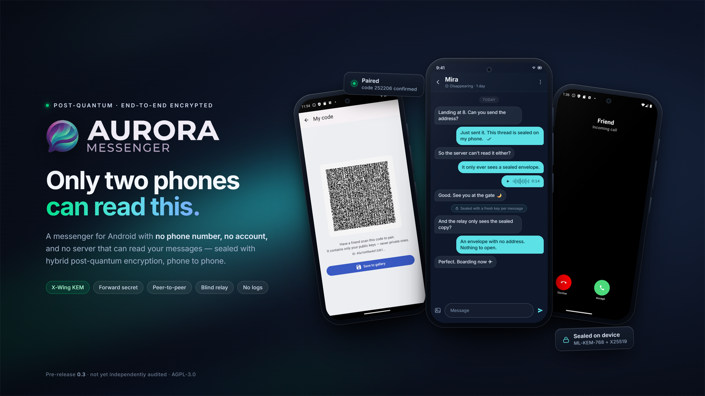
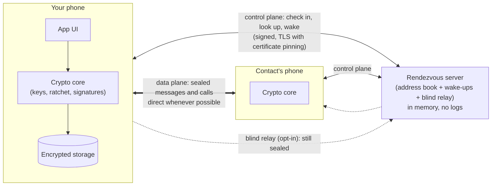
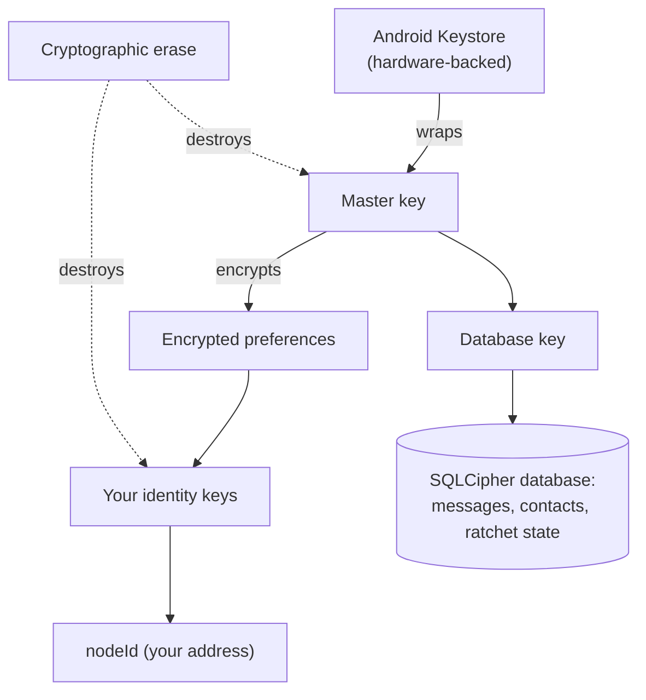
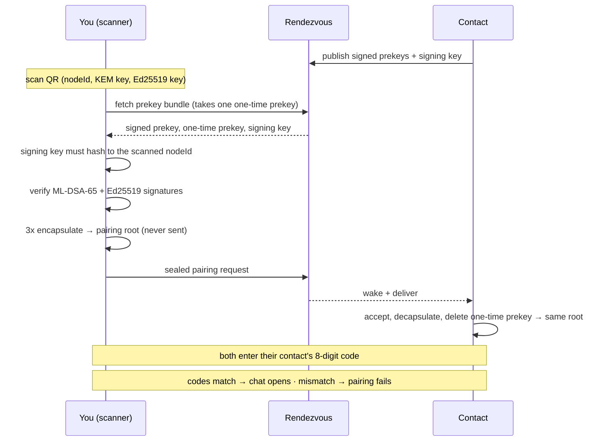
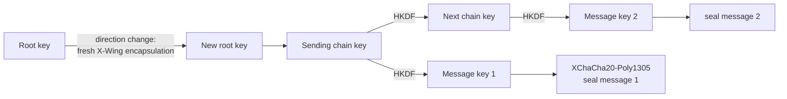
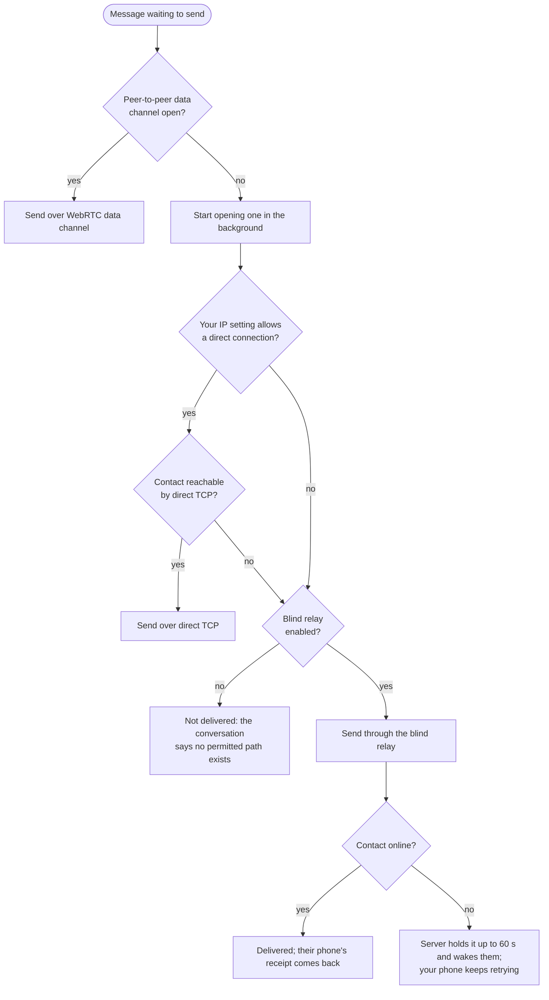
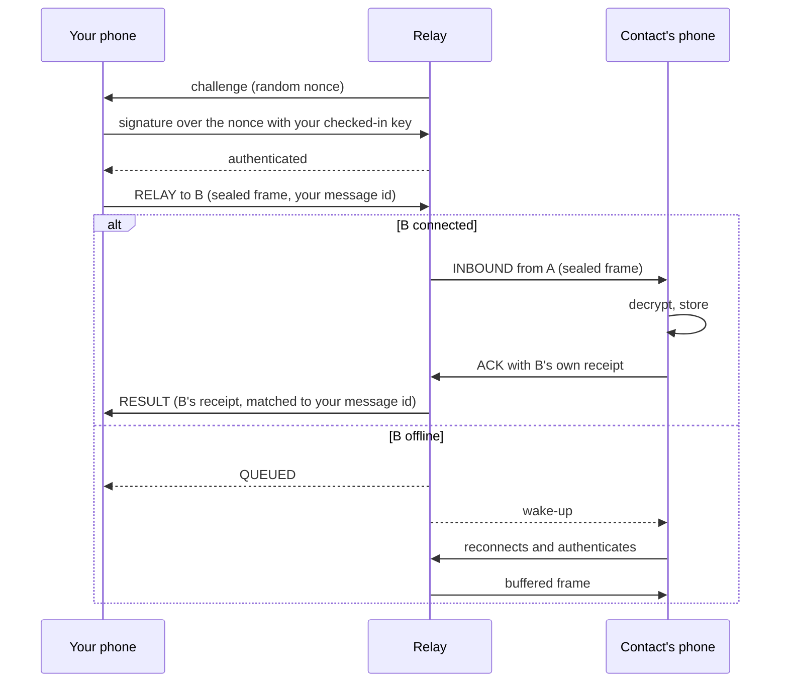
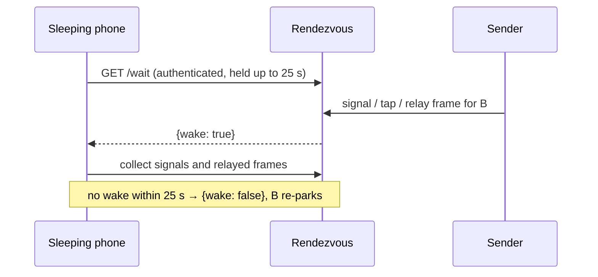
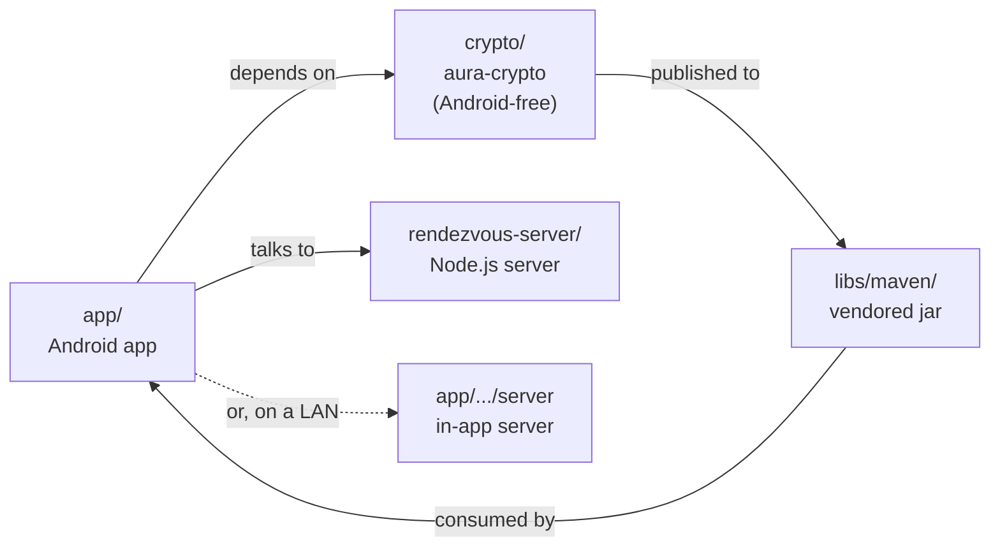

<picture>
  <source srcset="docs/branding/aurora-hero-1760x990.webp" type="image/webp">
  
</picture>

# Aurora Messenger

**A post-quantum, end-to-end encrypted messenger for Android.** No phone number, no account,
no server that can read your messages. You pair with someone by scanning their QR code, confirm
each other with a short code, and from then on your messages and calls go straight from one
phone to the other.

Aurora is built so that a conversation stays private even if:

- a server is compromised or run by someone hostile,
- one of your keys is stolen later,
- today's public-key cryptography is broken by a future quantum computer.

> **Status: pre-release (0.3.0-pre, plus unreleased changes on `main`).** The cryptographic
> core, pairing, messaging, media, calls, relay, and at-rest protection are implemented and
> covered by automated tests (see the dated [test status](docs/TEST_STATUS.md)).
> **It has not had an independent security audit.** Don't rely
> on it for high-risk situations until it has.

---

## Contents

1. [At a glance](#1-at-a-glance)
2. [Features](#2-features)
3. [How Aurora works: the big picture](#3-how-aurora-works-the-big-picture)
4. [Your identity](#4-your-identity)
5. [Pairing with a contact](#5-pairing-with-a-contact)
6. [How a message is encrypted](#6-how-a-message-is-encrypted)
7. [How a message travels](#7-how-a-message-travels)
8. [Voice and video calls](#8-voice-and-video-calls)
9. [Privacy controls: who sees your IP address](#9-privacy-controls-who-sees-your-ip-address)
10. [What the server can and cannot see](#10-what-the-server-can-and-cannot-see)
11. [Data on your phone](#11-data-on-your-phone)
12. [Cryptography reference](#12-cryptography-reference)
13. [Security claims and non-claims](#13-security-claims-and-non-claims)
14. [Project layout](#14-project-layout)
15. [Build, test, and run](#15-build-test-and-run)
16. [Running your own rendezvous server](#16-running-your-own-rendezvous-server)
17. [Documentation for auditors](#17-documentation-for-auditors)
18. [Design notes and background](#18-design-notes-and-background)
19. [License and author](#19-license-and-author)

---

## 1. At a glance

| | Aurora |
|---|---|
| **Account needed** | None: no phone number, email, or username |
| **Who can read messages** | Only the two phones in the conversation |
| **Encryption** | Hybrid post-quantum + classical, end to end, with per-message forward secrecy and self-healing keys |
| **How you add a contact** | Scan their QR code, then both confirm a 8-digit code |
| **Where messages go** | Phone to phone. A blind relay (which cannot read them) exists but is **off by default** |
| **What the server stores** | A short-lived "this device is reachable at this address" record, in memory only, no logs |
| **Conversations** | One-to-one today (group tables and tests exist, but the feature is not reachable from the UI); one device per identity |
| **Platform** | Android 10+ (API 29), Kotlin + Jetpack Compose |
| **License** | AGPL-3.0-or-later |

---

## 2. Features

| Area | What you get |
|---|---|
| **Messaging** | Text, replies, emoji reactions, per-conversation disappearing-message timers, on-device conversation streaks |
| **Media** | Photos, videos (in-app player with seek bar, decrypted in memory), voice messages; all stored encrypted |
| **Calls** | Voice and video (WebRTC) with real ringing, lock-screen handling, an in-app ongoing-call bar and a floating overlay; calls survive leaving the app |
| **Pairing** | QR code + mutual 8-digit verification; rejects mismatched codes, with the short-code limitation described below |
| **Delivery** | Peer-to-peer data channel, direct TCP on the same network, or a blind relay you can opt into as a last resort; offline messages are retried and the recipient is woken |
| **Privacy** | Choose who may learn your IP address; no third-party push service; the server keeps no logs |
| **Device security** | App lock with a **decoy PIN**, optional **duress wipe**, screenshot and recents blocking, root warning |
| **Erase** | Cryptographic erase: destroying keys makes all on-disk data unreadable instantly |
| **Backups** | Opt-in, passphrase-protected (Argon2id + XChaCha20-Poly1305) |
| **System integration** | Contacts appear in the Android share sheet |

---

## 3. How Aurora works: the big picture

Aurora separates **finding each other** (the control plane) from **talking to each other** (the
data plane). The rendezvous server helps with the first and never sees the content of the second.



The pieces, in the order you meet them:

| Step | What happens | Section |
|---|---|---|
| 1 | Your phone generates its keys; their hash becomes your address (**nodeId**) | [§4](#4-your-identity) |
| 2 | You scan a contact's QR code and run a forward-secret handshake | [§5](#5-pairing-with-a-contact) |
| 3 | You both confirm a 8-digit code to detect an intercepted pairing | [§5](#5-pairing-with-a-contact) |
| 4 | Every message is sealed with a fresh key from a post-quantum ratchet | [§6](#6-how-a-message-is-encrypted) |
| 5 | The sealed message takes the best available path to your contact | [§7](#7-how-a-message-travels) |

---

## 4. Your identity

On first launch your phone generates two key pairs. Nothing is registered anywhere.

| Key | Algorithm | Used for |
|---|---|---|
| **KEM key** | X-Wing (ML-KEM-768 + X25519) | Others encrypt key material to you |
| **Signing key** | ML-DSA-65 + Ed25519 | You prove messages and prekeys are yours |

Your address is a **fingerprint of those keys**:

```
nodeId = SHA3-256( KEM public key ‖ signing public key )
```

Because the address *is* a commitment to the keys, nobody can claim your address with different
keys, and anyone can check that a key really belongs to an address. (The trade-off: keys can't
be rotated without changing identity.)

Where the keys live:



Post-quantum keys are too large for the Keystore's secure hardware directly, so they're stored
encrypted under a Keystore-held master key: the practical hardware-backed compromise.

---

## 5. Pairing with a contact

Pairing does two jobs: **agree on a shared secret that nobody else can rebuild later**
(forward secrecy), and **prove there's nobody in the middle** (mutual verification).

### The steps

| # | You (scanner) | Your contact | Why |
|---|---|---|---|
| 1 | Scan their QR: nodeId, KEM key, Ed25519 key | Shows their QR | The QR is the trust anchor |
| 2 | Fetch their **prekey bundle** from the server | Published it earlier | Prekeys are too big for a QR |
| 3 | Check the bundle's signing key hashes (with the QR's KEM key) to the scanned nodeId | | The server can't swap in its own key |
| 4 | Verify **both** signature halves (ML-DSA-65 and Ed25519) on each prekey | | Forging one requires breaking both |
| 5 | Encapsulate to their identity key, signed prekey, and one-time prekey; derive the pairing root | | Three-way agreement = forward secrecy |
| 6 | Send the pairing request | Sees an incoming request: **Accept** or **Reject** | No silent contact creation |
| 7 | | Destroys the one-time prekey, derives the same root | A later key theft can't rebuild it |
| 8 | Both phones show a 8-digit code; each types the **other's** | | A man-in-the-middle gets mismatched codes |
| 9 | Chat opens | Chat opens | Verified both ways |



**Fails closed.** If no verifiable prekey bundle is available (none published, server down, or
an attacker suppressing it), pairing stops rather than continuing without forward secrecy.

**Why sharing a QR over a chat app is OK:** the 8-digit codes are computed on each phone from
the session and never transmitted. Someone who intercepted the QR and sat in the middle would
end up with a different session on each side, so the codes wouldn't match. Wrong entries are
attempt-limited, and repeated failures block and wipe the pending contact.

---

## 6. How a message is encrypted

Every conversation runs a **KEM Double Ratchet**: Signal's Double Ratchet design with the
Diffie-Hellman step replaced by the post-quantum X-Wing KEM.



- **Per message:** a new message key is derived and the old chain key is thrown away, so a key
  stolen today can't decrypt earlier messages (**forward secrecy**).
- **Per reply:** each time the conversation changes direction, the sender mixes fresh
  post-quantum randomness into the root key. A stolen session state stops working once both
  sides have replied (**post-compromise security**, or "healing").
- **Tamper-proof headers:** the ratchet header is bound into the encryption as associated data;
  a forged or altered frame is rejected without disturbing the live session.
- **Out of order:** late messages are handled (up to 1024 cached keys; a frame more than 512
  ahead is refused to stop flooding).
- **One ratchet for everything:** messages, media, and call signaling all seal through the same
  per-contact ratchet, separated by per-purpose labels (`aura-msg-v1`, `aura-media-v1`,
  `aura-call-v1`, `aura-rtc-v1`).

| Property | Provided by |
|---|---|
| Confidentiality | XChaCha20-Poly1305 with per-message keys |
| Forward secrecy (handshake) | One-time prekeys destroyed after use (PQXDH) |
| Forward secrecy (messages) | Chain keys discarded after each message |
| Post-compromise healing | Fresh X-Wing encapsulation on each direction change |
| Quantum resistance | ML-KEM-768 / ML-DSA-65 alongside X25519 / Ed25519: both must break |

> The ratchet follows a well-studied pattern and passes its adversarial test suite, but it is
> bespoke protocol code that hasn't had dedicated external review. Treat the healing guarantee
> as provisional until it has ([`docs/PQ_RATCHET_DESIGN.md`](docs/PQ_RATCHET_DESIGN.md)).

---

## 7. How a message travels

Every path carries the **same sealed frame**, so the path only affects speed and what network
metadata is exposed, never whether content is readable.

### Choosing a path



| Path | Used when | Who learns your IP | Speed |
|---|---|---|---|
| **WebRTC data channel** | Usually; crosses most carrier NATs (IPv6 first, then IPv4) | Your contact (unless relay-only) | Fast |
| **Direct TCP** | Same Wi-Fi or directly reachable | Your contact | Fastest |
| **Blind relay** (opt-in, off by default) | You enabled it, and nothing direct works or your setting forbids it | Only the server | Good |

A message is only marked **delivered** when the recipient's phone has decrypted and stored it
and sent back its own receipt, on every path.

### The blind relay

The relay is a WebSocket on the rendezvous server that passes sealed frames between two
authenticated phones. It cannot decrypt them.

**It is off by default.** Messages are delivered peer-to-peer; the relay is a transport you
turn on explicitly in **Settings → Privacy**, after a warning that encrypted messages and
their metadata (who, when, how large) will pass through the server. Turning it off never
disables discovery, address lookups, or wake-ups — those are separate signalling calls and
keep working either way. If a message cannot be delivered and the relay is off, the
conversation says so instead of leaving it silently pending.



- Nobody can connect as you: the server only accepts a signature over a fresh random challenge,
  checked against the key you registered.
- Only the phone a message was addressed to can confirm it, so a third party can't fake delivery.
- A frame that reaches a phone but isn't confirmed is redelivered; duplicates are recognized by
  message id.

### Waking a sleeping phone

Aurora doesn't use Google/Firebase push. A backgrounded phone keeps one authenticated long-poll
open to the server (`/wait`). When someone signals, taps, or relays to it, the server answers
"wake up" (no content), and the phone comes online to collect.



The honest cost: the server can tell your phone is online. That's disclosed rather than hidden.

---

## 8. Voice and video calls

Calls use WebRTC. Call setup messages (offer, answer, network candidates) are sealed by the same
ratchet and passed through the server as opaque signals; the audio and video then flow directly
between phones, encrypted by WebRTC's DTLS-SRTP.

| Detail | Behavior |
|---|---|
| Audio | Opus asked to run at **constant bitrate** (64 kbps cap), so packet sizes don't follow speech patterns |
| Video | Capped at 2.5 Mbps |
| Network changes | Candidates keep being gathered so a Wi-Fi ↔ mobile switch can recover |
| Busy | A second call can't start while one is active; an unanswered call stops ringing on its own |
| Background | A foreground service keeps the microphone and camera so leaving the app doesn't drop the call |
| Relay-only mode | Calls are limited to TURN-relayed paths, which needs a TURN server ([§16](#16-running-your-own-rendezvous-server)) |

---

## 9. Privacy controls: who sees your IP address

A direct connection necessarily tells the other phone your IP address. **Settings → Privacy →
"Who can see your IP address"** decides when that's allowed:

| Setting | Direct connections allowed with | Effect |
|---|---|---|
| **Any contact (fastest)**, default | Every contact | Best speed; contacts can see your IP |
| **Verified contacts only** | Contacts you've both verified with the 8-digit code | Unverified contacts can only be reached through the relay |
| **Never: always relay** | Nobody | Nothing direct; needs the relay or a TURN server |

In the relayed modes, WebRTC is restricted to relayed candidates for both messages and calls, so
your IP isn't exposed through the data channel either. The rendezvous server still sees your IP
in every mode; it has to, to deliver anything.

**A relay-only policy needs the relay switched on to deliver anything.** The app refuses to
select "Never: always relay" while the relay is off, and the conversation shows a "not
delivered" banner if the combination is reached another way. With the relay off, "Verified
contacts only" leaves unverified contacts undelivered until they verify or you change the
setting.

---

## 10. What the server can and cannot see

| The server **can** see | The server **cannot** see |
|---|---|
| That a nodeId is online and its IP address | Message, media, or call content |
| Which nodeIds signal to which, and when; **only if you enable the relay**, which messages pass through it | Your contacts list or message history (it keeps none) |
| Frame sizes and timing | Your private keys |
| Prekey bundles (public keys only) | Who you are: there's no account, phone number, or email |

How the server limits even that:

- **In memory only**, 15-minute record lifetime; a restart wipes everything.
- **No logs** beyond two startup lines; no IPs, nodeIds, or payloads are logged.
- **Decoy lookups:** the standalone server returns HTTP 200 with 10 candidates for both
  registered and unknown nodes. Registered nodes have one signed record plus nine decoys;
  unknown nodes have ten decoys. Someone with the target's verification keys can still
  distinguish a valid record. The server itself knows the real mapping.
- **Authenticated reads:** only the key holder can read their own queued signals or relayed frames.
- **Signed check-ins** bound to the nodeId, so nobody can register your address.
- **Rate limits and caps** on every endpoint, including each sender IP's share of a queue.
- **TLS with certificate pinning** in the app, so even a rogue certificate authority can't intercept.
- **AGPL source pointer** at `/source`: anyone running a modified server must publish its source.

---

## 11. Data on your phone

| What | Protected by | Notes |
|---|---|---|
| Messages, contacts, ratchet and prekey state | SQLCipher (AES-256) with a Keystore-protected key | Schema versioned so updates keep your data |
| Identity keys and settings | Encrypted preferences under a Keystore master key | |
| Photos, videos, voice messages | Ratchet-derived media key | Decrypted only in memory; never written in plaintext |
| Backups (opt-in) | Argon2id(passphrase) → XChaCha20-Poly1305 | Passphrase never stored |

- **Cryptographic erase:** wiping destroys the keys rather than overwriting the data. Flash
  storage makes overwriting unreliable, but ciphertext without its key is just noise.
- **Decoy PIN** opens an empty app; with **duress wipe** on, it erases everything instead.
- **Disappearing messages** are erased on both phones when their timer runs out.
- **Deleting a contact** removes its messages, media, and keys, and tells the other phone to do the same.
- **Screen protection:** screenshots, screen recording, and the recents preview are blocked in release builds.

At-rest protection assumes a locked, uncompromised phone. A rooted or infected device defeats any
messenger's encryption; Aurora warns when it detects root, but can't prevent this.

---

## 12. Cryptography reference

| Purpose | Algorithm | Parameters | Library |
|---|---|---|---|
| Key agreement | **X-Wing**: ML-KEM-768 (FIPS 203) + X25519 | NIST level 3 + Curve25519 | Bouncy Castle 1.85 |
| Signatures | **ML-DSA-65** (FIPS 204) + **Ed25519** | 3309 B + 64 B; both must verify | Bouncy Castle 1.85 |
| Encryption | **XChaCha20-Poly1305** | 256-bit key, 192-bit nonce | Google Tink 1.18 |
| Key derivation | HKDF-SHA-256 (RFC 5869) | | Bouncy Castle |
| Hashing / identity | SHA3-256 | | Bouncy Castle |
| Backup passphrase | Argon2id | | Bouncy Castle |
| Database | SQLCipher | AES-256 | SQLCipher 4.9.0 |

The `crypto` module is pure JVM (Bouncy Castle + Tink) and no longer calls liboqs. The Android
app still includes native SQLCipher and WebRTC libraries. Note that the unused
`liboqs-java-0.3.0` artifact is **still vendored** in `libs/maven/org/openquantumsafe` and
should be deleted before any release; it is dead weight, not a runtime dependency.
Correctness is checked against independent
references: **NIST ACVP** known-answer tests (ML-KEM-768, ML-DSA-65), **Wycheproof** edge-case
corpora (X25519, Ed25519, XChaCha20-Poly1305, ML-KEM-768, ML-DSA-65), and the RFC 8032 / 7748 /
5869 vectors. Exact wire formats and labels are in [`docs/CRYPTO_SPEC.md`](docs/CRYPTO_SPEC.md).

---

## 13. Security claims and non-claims

Current limitations and pending validation are tracked in
[`docs/PROJECT_STATUS.md`](docs/PROJECT_STATUS.md). In particular, the eight-digit pairing
code has about 26.6 bits of entropy; it does not offer unlimited resistance to an active
attacker who can repeat handshakes. Server metadata privacy and 16 KB Android page-size
compatibility also remain open work.

**Aurora aims to guarantee:**

| Claim | How |
|---|---|
| Content confidentiality, end to end | Hybrid post-quantum + classical encryption; no server, relay included, can read content |
| Authenticity and integrity | Hybrid signatures and authenticated encryption |
| Forward secrecy | Per-message ratchet + forward-secret PQXDH handshake |
| Post-compromise healing | KEM Double Ratchet (review-gated, see below) |
| Man-in-the-middle-resistant pairing | Mutual 8-digit verification fails closed |
| Identity binding | `nodeId = SHA3-256(keys)`; prekey signing keys must hash to the nodeId |
| Post-quantum resistance | An attacker must break both the post-quantum and the classical primitive |
| Metadata minimization | No account; in-memory, no-log server; decoy lookups; optional IP hiding |
| At-rest protection | SQLCipher + Keystore; instant cryptographic erase |

**Aurora does NOT (yet) claim:**

- **A reviewed ratchet:** the KEM Double Ratchet hasn't had dedicated external review.
- **Endpoint security:** a compromised phone defeats end-to-end encryption.
- **Anonymity:** it hides content and identities, not that you use Aurora, and the server sees
  your IP. There's no traffic-analysis resistance on the default path.
- **Delivery guarantees against a hostile server:** a malicious relay can drop frames or fake a
  delivery receipt (it still can't read or alter content).
- **Availability:** a single rendezvous server offers no denial-of-service guarantees.
- **Groups or multiple devices:** strictly two people, one device each.
- **An independent audit:** none has been performed yet.

Full reasoning: [`docs/THREAT_MODEL.md`](docs/THREAT_MODEL.md) and [`docs/AUDIT_SCOPE.md`](docs/AUDIT_SCOPE.md).

---

## 14. Project layout



| Path | Contents |
|---|---|
| `app/` | Android app: Kotlin, Jetpack Compose, Hilt, Room/SQLCipher, WebRTC |
| `crypto/` | `com.aura:aura-crypto`, the Android-free crypto core: hybrid KEM and signatures, HKDF, KEM Double Ratchet, prekeys, prekey verification |
| `app/src/main/kotlin/com/aura/transport` | Message sending, WebRTC data channel, TCP, blind relay client, IP-exposure gate |
| `app/src/main/kotlin/com/aura/pairing` | QR payload, scanner/receiver pairing, SAS verification |
| `app/src/main/kotlin/com/aura/server` | In-app rendezvous server (NanoHTTPD) for local/host mode |
| `rendezvous-server/` | Standalone Node.js rendezvous server, zero dependencies, with its own test suite |
| `libs/maven/` | Vendored `aura-crypto` artifact so a fresh clone builds on its own |
| `app/schemas/` | Room schema exports (migration baseline) |
| `docs/` | Specs, threat model, audit scope, test status |

Main app packages:

| Package | Responsibility |
|---|---|
| `identity` | Key generation and storage |
| `network` | Rendezvous client, sync loop (check-in, wake, retries) |
| `transport` | Delivery paths and frame handling |
| `pairing` | Handshake and verification |
| `call` | WebRTC call state machine and media |
| `db` | Encrypted database, contact erase |
| `security` | App lock, decoy PIN, secure wipe, root detection |
| `media`, `disappearing`, `reaction`, `streak`, `backup` | The features of the same names |
| `ui` | Compose screens |

---

## 15. Build, test, and run

**Requirements:** JDK 17, Android SDK 34, Node.js 18+ (server tests only).

```bash
# Build the app
./gradlew assembleDebug

# Run the tests
./gradlew -p crypto test                 # crypto core (pure JVM)
./gradlew -p crypto publish              # REQUIRED after crypto changes; see below
./gradlew :app:testDebugUnitTest         # app (Robolectric)
cd rendezvous-server && node --test      # rendezvous server
```

> **Republish the crypto module before testing the app.** The app uses `aura-crypto` from the
> jar vendored in `libs/maven`, not straight from `crypto/`. After changing anything under
> `crypto/`, run `./gradlew -p crypto publish`, or the app builds and tests against the old
> crypto. CI does this automatically.

On Windows, use `.\gradlew.bat` and set `JAVA_HOME` (Android Studio's bundled `jbr` works).

| Suite | Tests | What it covers |
|---|---|---|
| `crypto` | 161 | Primitives, NIST ACVP and Wycheproof vectors, ratchet (incl. healing and attacks), prekeys and prekey verification |
| `app` | 233 | Database and migrations, pairing and SAS, end-to-end message simulations, PQXDH handshake, relay client and its opt-in gate, media IP-exposure gate (outbound and inbound), app-lock PIN guard, SDP handling, security orchestration |
| `rendezvous-server` | 18 | Relay auth and delivery, crash resistance, malformed frames, queue fairness, TURN gating, prekey bundles |

Counts above are from the 2026-10-29 run (412 total: 161 + 233 + 18). The app suite was
re-run after the media-gate (outbound and inbound) and app-lock changes; the crypto and server
figures are the last recorded runs.
All three run in GitHub Actions on every push. Details: [`docs/TEST_STATUS.md`](docs/TEST_STATUS.md).
Some paths (live two-phone calls, QR camera scanning) still need physical devices.

---

## 16. Running your own rendezvous server

The server is a single dependency-free Node.js file.

```bash
cd rendezvous-server
PORT=8080 node index.js
```

| Environment variable | Default | Effect |
|---|---|---|
| `PORT` / `HOST` | `8080` / `0.0.0.0` | Listen address |
| `STRICT_BINDING` | on | Require nodeId ↔ key binding on check-in (`0` only for legacy clients) |
| `COTURN_SHARED_SECRET` | unset | coturn `static-auth-secret`; while unset, TURN credentials are disabled |
| `TURN_REALM` / `TURN_PORT` | `turn.auroramessenger.com` / `5349` | Advertised TURN URIs |
| `SOURCE_URL` | this repository | AGPL §13 source pointer; set it if you run a modified version |

For production, put it behind a TLS terminator (Caddy or nginx). The app pins the public
server's certificate; to use your own server, set its address under Settings → Developer
options. A self-hosted **coturn** gives NAT traversal (STUN) and, with `COTURN_SHARED_SECRET`
set, the TURN relay that relay-only calls need.

| Endpoint | Purpose |
|---|---|
| `POST /checkin` · `GET /find/:id` | Register your address; look up a contact's (with decoys) |
| `POST /signal/:id` · `GET /signal/:id` | Queue / collect sealed signals (pairing, call setup) |
| `POST /tap/:id` · `GET /wait/:id` | Wake a phone / wait to be woken |
| `POST /prekeys/:id` · `GET /prekeys/:id` | Publish / fetch prekey bundles |
| `GET /turn-credentials/:id` | Short-lived TURN credentials (if configured) |
| `WS /relay/stream` | Blind relay |
| `GET /health` · `GET /source` | Liveness · AGPL source pointer |

Wire formats: [`docs/PROTOCOL_RENDEZVOUS.md`](docs/PROTOCOL_RENDEZVOUS.md).

---

## 17. Documentation for auditors

Aurora is being prepared for independent review. Pin any review to a specific commit or tag so
findings map to exact source.

| Document | Covers |
|---|---|
| [`SECURITY.md`](SECURITY.md) | Reporting a vulnerability; scope; safe harbor |
| [`docs/AUDIT_SCOPE.md`](docs/AUDIT_SCOPE.md) | Scope, assumptions, known limitations, residual risks |
| [`docs/ARCHITECTURE.md`](docs/ARCHITECTURE.md) | Components, trust boundaries, diagrams |
| [`docs/CRYPTO_SPEC.md`](docs/CRYPTO_SPEC.md) | Primitives, formats, handshake, ratchet, SAS, prekeys |
| [`docs/PQ_RATCHET_DESIGN.md`](docs/PQ_RATCHET_DESIGN.md) | KEM Double Ratchet design and security argument |
| [`docs/PROTOCOL_RENDEZVOUS.md`](docs/PROTOCOL_RENDEZVOUS.md) | Rendezvous and blind-relay wire protocol |
| [`docs/THREAT_MODEL.md`](docs/THREAT_MODEL.md) | STRIDE + LINDDUN threat model |
| [`docs/KEY_MANAGEMENT.md`](docs/KEY_MANAGEMENT.md) · [`docs/DATA_AT_REST.md`](docs/DATA_AT_REST.md) | Key lifecycle and stored data |
| [`docs/DEPENDENCIES.md`](docs/DEPENDENCIES.md) · [`docs/BUILD_REPRODUCIBILITY.md`](docs/BUILD_REPRODUCIBILITY.md) | Supply chain and build |
| [`docs/TEST_ARCHITECTURE.md`](docs/TEST_ARCHITECTURE.md) · [`docs/TEST_STATUS.md`](docs/TEST_STATUS.md) | Test strategy and status |
| [`CHANGELOG.md`](CHANGELOG.md) | Release history |

---

## 18. Design notes and background

Aurora didn't start from scratch. It was carved out of an earlier, much larger project
(**ShadowMesh**, a post-quantum *mesh* messaging stack), and most of Aurora's architecture,
especially the cryptographic core, is ported from it rather than reinvented.

The deliberate decision was one of **scope**. Rather than try to ship the full mesh, I set
ShadowMesh aside for now and took its proven, working parts to build something smaller and
finishable: a direct, two-person, post-quantum encrypted messenger. A tight scope is what makes
Aurora something that can actually reach people's hands, while still standing on a serious
cryptographic foundation.

ShadowMesh itself is **paused, not abandoned.** I haven't yet decided whether it continues as a
standalone project or folds in as the **mesh/relay backend for Aurora**. The dormant ShadowMesh
scaffold in Aurora is the seam where that would happen. Either way, Aurora is the
near-term focus, and it is expected to **grow well beyond its current scope** over time; today's
two-person messenger is a foundation, not the finished shape.

### Key design decisions

| Decision | Why | Cost |
|---|---|---|
| Hybrid post-quantum + classical everywhere | Must break both; hedges against a flaw in either | Larger keys and signatures |
| Forward secrecy from destroyed one-time prekeys | Algorithm strength alone can't stop "record now, steal the key later" | Needs server-hosted prekey bundles |
| Prekeys on the server, not in the QR | The QR is already near capacity with the X-Wing key; it's also how X3DH works | Pairing needs the server reachable |
| Prekey signing key bound to the nodeId | Lets the scanner verify ML-DSA signatures without a bigger QR | One extra hash check |
| Recognize-then-verify pairing with a mutual code | Makes sharing a QR over an untrusted channel safe | One extra step for users |
| `nodeId = SHA3-256(keys)` | Address can't be claimed with substitute keys | Keys can't rotate without a new identity |
| KEM Double Ratchet | Forward secrecy and healing, both post-quantum | Bespoke code, pending review |
| Direct P2P with a near-zero-knowledge server | Messages avoid the server whenever possible | The server learns reachability |
| Blind relay as an opt-in last resort | Delivers across any NAT without exposing IPs to contacts | The relay sees who talks to whom |
| Contentless wake instead of Firebase push | No push provider; no content leaves the phone | The server can tell a phone is online |
| Cryptographic erase instead of scrubbing | Flash wear-leveling makes overwriting unreliable | Requires keys to be well protected |
| TLS certificate pinning | Interception fails even with a rogue CA | Pins must be managed across renewals |

### LAN host-beacon (dormant)

The code contains a serverless **host-beacon** mode: the initiator runs the in-app rendezvous
server and puts reachable LAN or port-mapped URLs in the QR for same-Wi-Fi pairing. **It isn't
reachable from the shipped UI**; the app's "Show my code" uses the shared rendezvous, which works
across networks. It remains as a developer/testing option ([`docs/AUDIT_SCOPE.md`](docs/AUDIT_SCOPE.md)).

---

## 19. License and author

Aurora Messenger is licensed under the **GNU Affero General Public License v3.0**
(`AGPL-3.0-or-later`); see [`LICENSE`](LICENSE). The AGPL is used deliberately: if you run a
modified version of Aurora as a network service (for example the rendezvous server), you must
make your modified source available to its users (AGPL §13). Each server exposes a `/source`
endpoint for this reason. Third-party components are listed in
[`THIRD-PARTY-NOTICES.md`](THIRD-PARTY-NOTICES.md).

*This software is provided without warranty. It has not undergone an independent third-party
security audit; do not rely on it for high-risk threat models until it has.*

Built by **Christian Lim Correa**, a Filipino developer. Questions and security reports are
welcome at christiancorrea26@gmail.com.
